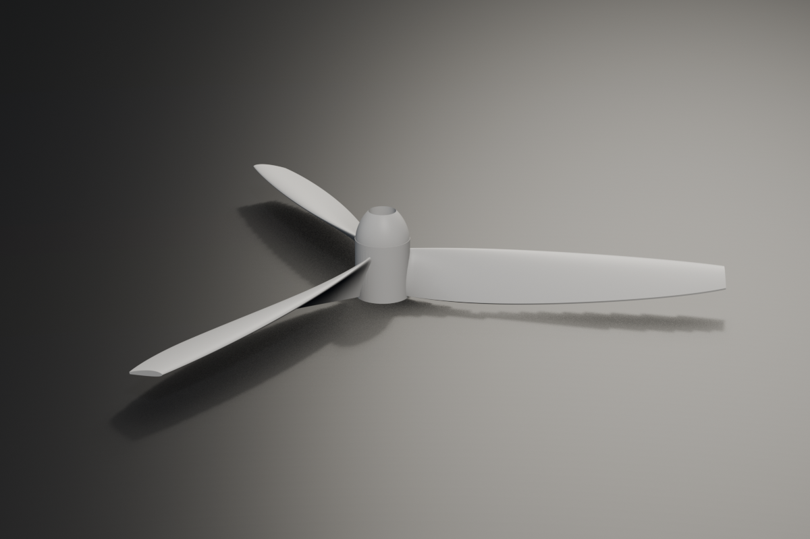

# Propeller Generator

[English](README.md) | **Français**

Générateur paramétrique d'hélices pour Blender 4.2+ (testé jusqu'à Blender 5.1).

Le panneau se trouve dans la vue 3D : `N` > barre latérale > onglet **Propeller**.



## Fonctionnalités

- 1 à 12 pales, section **NACA 4 chiffres** (racine / milieu / pointe, avec point de transition).
- Planforme de pale **ellipse**, **linéaire** ou **constante** : corde, longueur d'ellipse, ligne médiane, fairing, flèche et offset.
- Vrillage radial : pas en mm/tour (auto ou manuel) et pas de pointe.
- **Moyeu** paramétrique, **ogive** ou spinner **parabolique**.
- Alésage **cylindrique**, **D**, **hexagonal**, **claveté** ou aucun, avec profondeur et chanfrein.
- **Shroud** (cercle protecteur) optionnel, décollé de la pointe des pales.
- Maillage **étanche** (booléens séquentiels validés), normales cohérentes, lissage par angle.
- **UV** automatiques, matériau unique, couleur réglable.
- Unités réelles : cotes saisies en **millimètres**, objet généré en **mètres**, posé au sol.
- Six préréglages prêts à l'emploi.

## Installation

### Installation en un clic depuis GitHub (recommandé)

Ajouter cette URL de dépôt dans Blender :

`https://raw.githubusercontent.com/OlivierLAVAUD/propeller/main/docs/index.json`

1. `Edit > Preferences > Get Extensions`.
2. Dans le menu **Repositories**, cliquer sur **+** > **Add Remote Repository**.
3. Coller l'URL ci-dessus et valider.
4. Rechercher **Propeller Generator** et cliquer sur **Install**.

Les mises à jour sont récupérées depuis ce dépôt à chaque nouvelle release.

### Installation manuelle depuis la release

**[Télécharger la dernière version](https://github.com/OlivierLAVAUD/propeller/releases/latest)** — le zip de release est prêt à installer, aucune compilation nécessaire.

1. Télécharger `propeller_generator.zip` (lien direct :
   `https://github.com/OlivierLAVAUD/propeller/releases/latest/download/propeller_generator.zip`),
   ou le construire localement avec `.\build.ps1`.
2. Dans Blender : `Edit > Preferences > Get Extensions`, menu déroulant en haut à droite >
   **Install from Disk**, choisir le zip.
3. Vérifier que **Propeller Generator** est activé dans l'onglet *Add-ons*.

Le zip peut aussi être glissé-déposé directement dans la fenêtre de Blender.

### Add-on classique

Copier ce dossier sous le nom `propeller` dans `scripts/addons/`, puis activer
**Propeller Generator** dans `Edit > Preferences > Add-ons`.

## Utilisation

1. Ouvrir la barre latérale de la vue 3D (`N`) et cliquer sur l'onglet **Propeller**.
2. Choisir un préréglage ou régler les paramètres.
3. Cliquer sur **Generate Propeller** : l'objet est créé à l'origine, à l'échelle réelle.

Le bouton **Reset Defaults** remet tous les paramètres à leur valeur par défaut.

## Préréglages

| Préréglage | Usage typique |
| --- | --- |
| `RC Plane` | hélice d'avion RC, 3 pales, spinner ogive |
| `RB Plane` | hélice plane 2 pales |
| `Airplane` | hélice d'avion légère, 3 pales |
| `PC Fan` | ventilateur de boîtier PC |
| `Toy Boat` | hélice de bateau jouet, 3 pales |
| `Pullcopter` | hélice à tirer, shroud et alésage |

## Paramètres principaux

| Groupe | Paramètres |
| --- | --- |
| Propeller | nombre de pales, diamètre, sens de rotation, diamètre/hauteur de racine, pas |
| Blade | mode de corde, fraction de corde, longueur d'ellipse, ligne médiane, fairing, flèche, offset, pas de pointe |
| Airfoils | NACA racine/milieu/pointe, point de transition, épaisseur de bord de fuite |
| Hub & Shaft | extension du moyeu, type d'alésage (aucun, cylindre, D, hex, clavette), diamètre, profondeur, chanfrein, taille de clavette |
| Spinner | aucun, ogive ou parabolique ; montage sur moyeu, diamètre, longueur, arrondi |
| Shroud | activation, décalage, épaisseur, longueur, chanfrein |
| Output | couleur, orientation Z-up, échelle, pose au sol, lissage, UV, densité de points/segments |

## Compilation

```powershell
.\build.ps1
```

Le script lit la version dans `blender_manifest.toml`, vérifie la syntaxe Python,
puis produit `versions\propeller_generator_v<version>.zip` (contenu à plat :
`blender_manifest.toml` et `__init__.py` à la racine de l'archive).

## Structure

```
propeller/
  __init__.py            # code de l'add-on (mono-fichier)
  blender_manifest.toml  # métadonnées de l'extension
  build.ps1              # archive de release
  README.md              # readme anglais (par défaut)
  README.fr.md           # readme français
  CHANGELOG.md
  LICENSE
  docs/
    index.json           # index du dépôt d'extensions Blender
    preview.png          # aperçu du README
```

## Notes de version 1.0.1

- Sections de paramètres repliables : cliquer sur le titre d'une section pour
  afficher ou masquer ses réglages. Les sections avancées (Airfoils, Spinner,
  Shroud, Output) sont repliées par défaut.

## Notes de version 1.0.0

- Section de pale réellement plane : plus de pale repliée sur elle-même aux grandes cordes.
- Racine de pale rentrée dans le moyeu au lieu d'être tangente.
- Ogive et paraboloïde tangents au moyeu, sans décrochement.
- Cordes et longueurs bornées : plus de pale dégénérée quand `ellipse_length = 1.0`.
- Shroud décollé de la pointe des pales (offset minimal).
- Alésage D/hex/claveté correctement découpé, y compris le cube du cutter D.
- Booléens séquentiels par pale, avec validation du résultat et repli de solveur
  (`MANIFOLD` → `EXACT` → `FLOAT`) : plus de maillage vide silencieux.
- Matériau unique et slot correct, UV, lissage, orientation Z-up, unités mm → m et pose au sol.
- `Reset Defaults` réinitialise réellement toutes les propriétés.

## Licence

MIT (voir `LICENSE`).

Copyright (c) 2026 oLV - Olivier LAVAUD.
