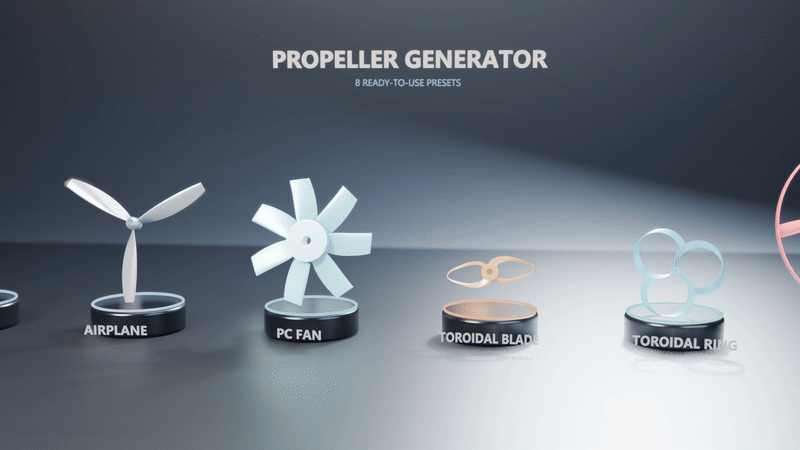

# Propeller Generator

**English** | [Français](README.fr.md)

Parametric propeller generator for Blender 4.2+ (tested up to Blender 5.1).

The panel is in the 3D View: `N` > sidebar > **Propeller** tab.



## Features

- 1 to 12 blades, **4-digit NACA** airfoil (root / mid / tip, with transition point).
- **Ellipse**, **linear** or **constant** blade planform: chord, ellipse length, centerline, fairing, sweep and offset.
- Radial twist: pitch in mm/rev (auto or manual) and tip pitch.
- Parametric **hub**, **ogive** or **parabolic** spinner.
- **Cylindrical**, **D**, **hex**, **keyway** or no shaft bore, with depth and chamfer.
- Optional **shroud** (propeller guard), offset from the blade tips.
- **Watertight** mesh (validated sequential booleans), consistent normals, angle-based smoothing.
- Automatic **UVs**, single material, adjustable color.
- Real-world units: dimensions in **millimeters**, object generated in **meters**, placed on the ground.
- Six ready-to-use presets.

## Demo


## Installation

### One-click install from GitHub (recommended)

Add this repository URL in Blender:

`https://raw.githubusercontent.com/OlivierLAVAUD/blender-propeller-generator/main/docs/index.json`

1. `Edit > Preferences > Get Extensions`.
2. In the **Repositories** menu, click **+** > **Add Remote Repository**.
3. Paste the URL above and confirm.
4. Search for **Propeller Generator** and click **Install**.

Updates are picked up from this repository when a new release is published.

### Manual install from the release

**[Download the latest release](https://github.com/OlivierLAVAUD/blender-propeller-generator/releases/latest)** — the release zip is ready to install, no build required.

1. Download `propeller_generator.zip` (direct link:
   `https://github.com/OlivierLAVAUD/blender-propeller-generator/releases/latest/download/propeller_generator.zip`),
   or build it locally with `.\build.ps1`.
2. In Blender: `Edit > Preferences > Get Extensions`, top-right dropdown >
   **Install from Disk**, select the zip.
3. Make sure **Propeller Generator** is enabled in the *Add-ons* tab.

The zip can also be dragged and dropped into the Blender window.

### Classic add-on

Copy this folder as `propeller` into `scripts/addons/`, then enable
**Propeller Generator** in `Edit > Preferences > Add-ons`.

## Usage

1. Open the 3D View sidebar (`N`) and click the **Propeller** tab.
2. Pick a preset or adjust the parameters.
3. Click **Generate Propeller**: the object is created at the origin at real-world scale.

The **Reset Defaults** button restores every parameter to its default value.

## Presets

| Preset | Typical use |
| --- | --- |
| `RC Plane` | RC aircraft propeller, 3 blades, ogive spinner |
| `RB Plane` | 2-blade propeller |
| `Airplane` | light aircraft propeller, 3 blades |
| `PC Fan` | PC case fan |
| `Toy Boat` | toy boat propeller, 3 blades |
| `Pullcopter` | pull propeller, shroud and bore |

## Main parameters

| Group | Parameters |
| --- | --- |
| Propeller | blade count, diameter, rotation direction, root diameter/height, pitch |
| Blade | chord mode, chord fraction, ellipse length, centerline, fairing, sweep, offset, tip pitch |
| Airfoils | root/mid/tip NACA, transition point, trailing-edge thickness |
| Hub & Shaft | hub extension, bore type (none, cylinder, D, hex, keyway), diameter, depth, chamfer, keyway size |
| Spinner | none, ogive or parabolic; hub mount, diameter, length, rounding |
| Shroud | enable, offset, wall, length, chamfer |
| Output | color, Z-up orientation, scale, ground placement, smoothing, UVs, point/segment density |

## Build

```powershell
.\build.ps1
```

The script reads the version from `blender_manifest.toml`, checks the Python syntax,
then produces `versions\propeller_generator_v<version>.zip` (flat layout:
`blender_manifest.toml` and `__init__.py` at the archive root).

## Structure

```
propeller/
  __init__.py            # add-on code (single file)
  blender_manifest.toml  # extension metadata
  build.ps1              # release archive
  README.md              # English readme (default)
  README.fr.md           # French readme
  CHANGELOG.md
  LICENSE
  docs/
    index.json           # Blender extension repository index
    preview.png          # README preview
```

## References

- NACA 4-digit airfoils: [Airfoil Tools](http://airfoiltools.com/airfoil/naca4digit)

## License

MIT (see `LICENSE`).

Copyright (c) 2026 oLV - Olivier LAVAUD.
